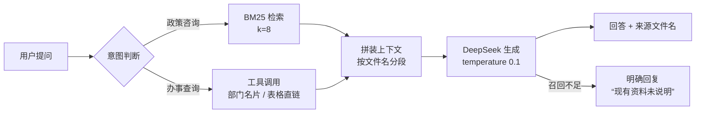

# SYSU Campus AI · 中山大学校园政策智能问答 Agent

把 83 份、358 页、22.4 万字的本科生制度文件，做成一个**每条政策事实都标出处、查不到就明说"未说明"**的问答入口。

[在线体验](https://sysu-rag-agent.streamlit.app) · 面向中大全日制本科生 · 只答学业政策与办事流程


| 指标 | 数值 |
|---|---|
| 语料规模 | 83 份 PDF / 358 页 / 22.4 万字 |
| 基准评测集 | 50 条，LLM-as-Judge 逐条判定 |
| 通过率 | **43 / 50 = 86%**（达标线 80%） |
| 回答约束 | 逐条标注来源文件名；召回不足时明确拒答 |

---

## 1. 要解决的问题

本科生的办事信息散在几百份制度文件里：辅修要多少学分、转专业什么条件、困难补助谁能申请——答案都在，但没人愿意翻 358 页 PDF。

调研过一圈同类工具，问题不在"答不出来"，而在**答得出来却不敢信**：不给出处、把两份文件的规定混在一起、没有依据时照着常识编。

所以这个项目的成功标准不是"能答"，而是：**每条政策事实都能回到原文，回不到就说不知道。**

## 2. 它怎么工作



**入库**（`ingest.py`）
PyPDFLoader 批量解析 → `RecursiveCharacterTextSplitter`（chunk 500 / overlap 100）→ `text2vec-base-chinese` 向量化 → 落 Chroma。每个 chunk 的 metadata 里写入来源文件名，检索后可回查。

**检索**（`rag_core.py`）
BM25，中文按 bigram 切分（政策文本里"辅修学士学位""学分绩点"这类术语必须整体命中，按单字切会散），`k=8`。

**工具**
两条高频且不需要生成的事：查部门地点电话、查表格下载链接。命中关键词直接返回结构化结果，不让模型自由发挥——这两种信息一旦编造，用户会白跑一趟。

**生成**
DeepSeek，`temperature=0.1`，prompt 里 6 条硬约束：只用召回片段和工具结果里的事实、控制在 1–3 句、每条政策事实标来源文件名、不同文件的规定分开说、召回不足说"未说明"、地点电话照工具结果答。

**降级**
没有 API Key 或调用异常时，直接返回检索到的原文段落，附文件名。宁可给原文，不给编造。

## 3. 几个刻意的取舍

**放弃"358 页全文投喂长上下文"。**
看起来最省事，但三个问题绕不过去：超窗口、每问一次全量计费、最要命的是**无法逐条溯源**——模型说了某条规定，你没法指出它出自哪份文件的哪一段。改成分块检索 + metadata 回查，成本降下来，出处才是真的。

**按"单文件独立入库"切分，文件名写进 metadata。**
政策文件之间大量交叉引用（学籍管理规定会引学位授予细则），混在一起切会把两份文件的条件缝成一条不存在的规则。评测里来源错位类 badcase 基本都出在这里，所以宁可切得碎一点，也要保住"这段属于谁"。

**v1 上线后删掉了侧边栏、快捷入口卡片和咨询按钮。**
这些入口指向的功能当时没做完。界面上留着，用户点进去是空的，比没有更伤——**入口即承诺**。现在只留品牌区、对话记录和输入框。

**回答允许说"未说明"。**
早期版本遇到召回不足会顺着常识补一句，评测里这类回答看着通顺，实际全是风险。现在 prompt 第 4 条硬性要求拒答，宁可少答一句。

## 4. 评测

50 条基准集覆盖课室与自习、奖助与困难补助、学籍异动（转专业/辅修/退学）、办事流程四类，`ground_truth` 逐条对照原文写，DeepSeek 作裁判，只输出 PASS / FAIL。

裁判标准定得刻意严：**关键条件遗漏、事实错误、与标准答案矛盾、无依据的具体信息，都判 FAIL**。所以 86% 是严口径下的数字，不是"看起来对"。

7 条失败逐条看过，归因如下（`eval_results.json` 里有完整问答对）：

| 类型 | 条数 | 典型表现 |
|---|---|---|
| 遗漏次要约束 | 3 | 自习室查询路径答对了，漏了"需保持安静、遵守课室使用公约" |
| 冗余延伸 | 1 | 只问本科生路径，把研究生路径也答了，被判答非所问 |
| 跨文件混淆 | 1 | 问困难补助代办，引到了《医疗补助基金管理办法》而非《特殊困难补助管理办法》 |
| 漏召回 | 1 | 问"什么情况不给补助"，没召回第六条，答成"办法里没有直接列" |
| 同义改写重复 | 1 | 与另一条近乎同义的问题表现不一致，暴露稳定性问题 |

最值得改的是**跨文件混淆**和**漏召回**：前者靠 metadata 加文件名过滤能压下去，后者需要扩召回窗口或补关键词。冗余延伸是 prompt 层面的，加一句"只回答所问"即可。

## 5. 本地运行

```bash
pip install -r requirements.txt

# 1) 准备语料：把校内制度 PDF 放进 data/
#    语料未随仓库分发，见下方说明
python ingest.py

# 2) 配置模型
export DEEPSEEK_API_KEY=sk-...

# 3) 启动
streamlit run app.py

# 4) 跑评测（可选）
python evaluate.py   # 结果写入 eval_results.json
```

目录：

```
app.py                # Streamlit 前端（含样式定制）
rag_core.py           # 检索 + 工具 + 生成 + 降级
ingest.py             # PDF 解析、切分、向量化入库
evaluate.py           # LLM-as-Judge 评测
generate_eval_set.py  # 评测集生成辅助
eval_dataset.json     # 50 条评测集
eval_results.json     # 逐条评测结果与判定
chroma_db/            # 已构建的向量库（线上运行所需）
```

## 6. 已知限制

- **语料未随仓库分发。** `data/` 下是学校内部制度文件，只保留在本地；仓库中的 `chroma_db/` 是已处理好的向量库，用于支撑线上 demo。
- **检索目前是 BM25 单路。** 向量库已建好（text2vec-base-chinese），但还没接进召回；下一步做 BM25 + 向量的 RRF 融合，重点压"跨文件混淆"这一类失败。
- **评测集 50 条，长尾不足。** 冷门条款（如特殊困难补助的负面清单）样本太少，分数对这类问题不敏感。
- **PDF 表格解析有损。** 涉及表格的条件判断，召回片段常丢列，是长尾失败的主要来源之一。

---

非官方项目，与中山大学无隶属关系；回答仅供办事参考，以学校正式文件为准。语料与示例问题均为公开制度文件内容。
