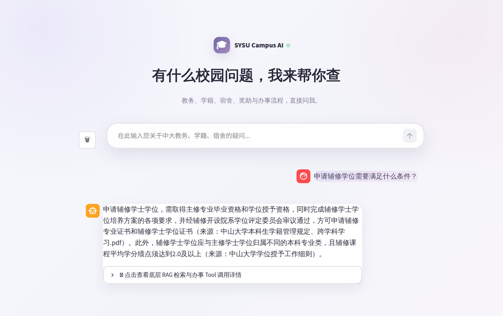
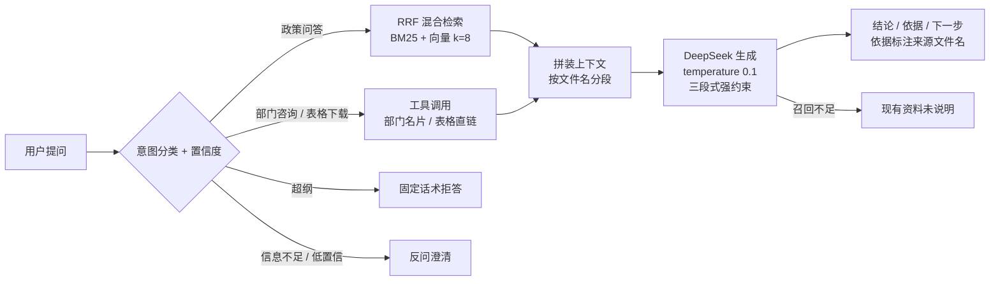

# SYSU Campus AI · 中山大学校园政策智能问答 Agent

把 83 份、358 页、22.4 万字的本科生制度文件，做成一个**每条政策事实都标出处、查不到就明说"未说明"**的问答入口。

[在线体验](https://sysu-rag-agent.streamlit.app) · 面向中大全日制本科生 · 只答学业政策与办事流程



| 指标 | 数值 |
|---|---|
| 语料规模 | 83 份 PDF / 358 页 / 22.4 万字 |
| 基准评测集 | 130 条（核心 50 + 长尾 80），LLM-as-Judge 逐条判定 PASS / FAIL |
| 通过率 | **118 / 130 = 90.8%**（严格判卷口径，达标线 80%；核心 96.0% · 长尾 87.5%） |
| 回答约束 | 三段式结构化输出、逐条标注来源文件名；超纲固定话术拒答、召回不足明说"未说明" |

---

## 1. 要解决的问题

本科生的办事信息散在几百份制度文件里：辅修要多少学分、转专业什么条件、困难补助谁能申请——答案都在，但没人愿意翻 358 页 PDF。

调研过一圈同类工具，问题不在"答不出来"，而在**答得出来却不敢信**：不给出处、把两份文件的规定混在一起、没有依据时照着常识编。

所以这个项目的成功标准不是"能答"，而是：**每条政策事实都能回到原文，回不到就说不知道。**

## 2. 它怎么工作



**意图路由：先判该不该答，再判怎么答。**
检索之前先让模型把问题归入五类（政策问答 / 部门咨询 / 表格下载 / 超纲 / 判断不了）并给出置信度：超纲用固定话术拒答并给替代办法；判断不了或低置信度先反问澄清，不硬答。顺序很重要——让模型拿不该答的问题去检索，越检索越错。同时有一条硬规则：**校内场景词（督导、自习室、社团借课室）不算超纲**——这条规则来自早期"意图误杀"的教训。

**入库**（`ingest.py`）
PyPDFLoader 批量解析 → `RecursiveCharacterTextSplitter`（chunk 500 / overlap 100）→ `text2vec-base-chinese` 向量化 → 落 Chroma。每个 chunk 的 metadata 里写入来源文件名，并在正文最前面注入「【文件说明：本片段来源于《xxx》】」前缀——哪怕切出来全是表格字段，模型也知道这段内容属于哪份文件。

**检索**（`rag_core.py`）
BM25（中文按 bigram 切分，"辅修学士学位"这类术语必须整体命中）+ 向量语义两路各取 8 篇，RRF 按 1/(60+rank) 融合重排。带 `RAG_HYBRID` 开关：语义模型不可用（冷启动下载失败、断网）时自动退回 BM25 单路，不阻断启动。

**工具**
两条高频且不需要生成的事：查部门地点电话、查表格下载链接。命中后直接返回结构化结果，不让模型自由发挥——这两种信息一旦编造，用户会白跑一趟。

**生成**
DeepSeek，`temperature=0.1`。三段式强约束：【结论】【依据】【下一步】缺一不可；【依据】每条必须是「《文件名》：原文摘录」，文件名原样照抄参考资料的来源标记，不得简写；召回不足时【结论】必须写"现有资料未说明"。前端做容错渲染：模型偶发未按格式输出时原样展示，不崩。

**降级**
没有 API Key 或调用异常时，直接返回检索到的原文段落，附文件名。宁可给原文，不给编造。

## 3. 评测与迭代

**评测集设计：拒绝"开卷考试"。**
题目不是从 PDF 里摘原句（那等于把答案摆在检索面前），而是先锚定官方原文作标准答案（ground_truth），再用学生口吻改写提问——保证标准答案准确、提问贴近真实表达。判卷由另一个 DeepSeek 实例担任，只输出 PASS / FAIL，标准刻意从严：关键条件遗漏、事实错误、无依据的具体信息都判 FAIL。

**数字迭代线（每一轮的涨跌都能说出原因）：**

| 轮次 | 样本 | 通过率 | 做了什么 | 为什么是这个数 |
|---|---|---|---|---|
| ① 初测 | 50 | 60% | 建评测集跑通基线 | 三类病根：召回截断（正确条款排第 7-8 被 Top-4 截掉）、跨文件混淆、判分误杀 |
| ② 修复 | 50 | 84% | Top-K 4→8、prompt 加"只用召回内容"硬约束、上下文带文件名 | 同口径对比，三处改动对应三类病根 |
| ③ 分层 | 130 | 75.4% | 统计覆盖率 → 清洗出处字段 → 一文件一题补 80 条长尾 | 原 50 条仍是 84%，掉的全是新补长尾（70%）——不是退步，是考试变难 |
| ④ 混检 | 130 | 79.2% | BM25+向量 RRF 融合，顺带修复向量库读取时 embedding 未挂载（向量检索此前静默失效） | 长尾 70%→75%；继续加召回 8→10 分数不动即停止——再调就是针对测试集刷分 |
| ⑤ 回归 | 130 | 86.9% | 意图路由与工具调用回路上线后例行回归 | 核心 96% 未动、长尾连掉 5 条——逐条归因：8 条回答停在"查询前独白"（模型发起的工具调用未被执行）、1 条意图误杀、其余为判卷波动 |
| ⑥ 定稿 | 130 | **90.8%** | 补全工具执行回路、收紧误杀口径后全量重跑 | 当前代码严格判卷口径实测：118/130，核心 96.0%、长尾 87.5% |

**分层揭示了什么：**
覆盖率脚本第一次跑出 0/83——不是文件没测到，是评测集出处字段带「（Q1）」「（第七条）」这类后缀，和 PDF 文件名精确匹配全部失败。改模糊匹配重算才发现：50 条全部挤在 3 份核心文件上，80 份文件零覆盖。也就是说 84% 只在那三份文件上成立。**不做分层，评测就是骗自己。**

**27 条错题的四类归因（先归因再改代码，不盲目调参）：**

| 病根 | 条数 | 典型表现 | 处置 |
|---|---|---|---|
| 出处错位 | 6 | 内容答对了、引用文件名对不上 | 先清洗评测集出处字段（先怀疑尺子）；入库注入【文件说明】前缀，出处跟着内容走 |
| 表格解析 | 5 | 纯表格 PDF 解析成字段乱码 | 已知缺陷：改解析器投入产出比不划算，如实记录、评测如实计入 |
| 长尾细节 | 10 | 答案只有一句话埋在长文里，关键词与语义都难命中 | RRF 混合检索 + 长尾补题 |
| QA 切分 | 3 | 问答对被切开，问题和答案分家 | 调整切分粒度，问答对整块入库 |

**口径纪律：**
中途一轮"放宽判卷"把分数抬到 87.7%，但长尾通过率反超核心、逻辑上说不通——这是改尺子不是改能力，整轮作废；局部重测 27 条救回 19 条后拼算出 93.8% 也被否决——另外 103 条没有重跑，拼出来的数字一定高估。上表第 ⑤ 轮的 86.9% 回归同样如此：意图路由上线后分数掉了，不是"越改越差"，是回归评测抓住了两个真问题（工具调用没执行、意图误杀），归因修复后以当前代码严格口径全量重跑定稿。**简历上的每一个数字，都是当前这份代码真实跑出来的。**

## 4. 几个刻意的取舍

**放弃"358 页全文投喂长上下文"。**
看起来最省事，但三个问题绕不过去：超窗口、每问一次全量计费、最要命的是**无法逐条溯源**——模型说了某条规定，你没法指出它出自哪份文件的哪一段。改成分块检索 + metadata 回查，成本降下来，出处才是真的。

**按"单文件独立入库"切分，文件名写进 metadata。**
政策文件之间大量交叉引用（学籍管理规定会引学位授予细则），混在一起切会把两份文件的条件缝成一条不存在的规则。宁可切得碎一点，也要保住"这段属于谁"。

**只做 2 个工具、不做多 Agent。**
部门电话与表格直链是学生最高频的两类办事需求，两个确定性工具足够覆盖；多 Agent 增加调度复杂度，却不增加可验证性。

**拒答用固定话术。**
让模型自由发挥拒绝的方式，它每次说的都不一样，用户会以为系统坏了。超纲拒答与澄清追问各配一条固定文案。

**v1 上线后删掉了侧边栏、快捷入口卡片和咨询按钮。**
这些入口指向的功能当时没做完。界面上留着，用户点进去是空的，比没有更伤——**入口即承诺**。现在只留品牌区、对话记录和输入框。

**回答允许说"未说明"。**
早期版本遇到召回不足会顺着常识补一句，评测里这类回答看着通顺，实际全是风险。现在 prompt 硬性要求拒答，宁可少答一句。

## 5. 已知限制

- **语料未随仓库分发。** `data/` 下是学校内部制度文件，只保留在本地；仓库中的 `chroma_db/` 是已处理好的向量库，用于支撑线上 demo。
- **表格类 PDF 解析有损。** 涉及表格的条件判断仍可能失败，评测中如实计入，未声称解决。
- **文件冲突只做兜底。** 两份文件对同一事项规定不一致时，提示列出双方条款、建议以最新文件为准；没有做主动冲突检测。
- **无联网更新机制。** 知识库里没有的新政策只能答"未明确"。
- **判卷模型存在波动。** 同一道题不同轮次可能翻转一两条，单轮分数小幅波动不作为结论，以全量重跑为准。

## 6. 本地运行

```bash
pip install -r requirements.txt

# 1) 准备语料：把校内制度 PDF 放进 data/
#    语料未随仓库分发，见下方说明
python ingest.py

# 2) 配置模型
export DEEPSEEK_API_KEY=sk-...

# 3) 启动
streamlit run app.py

# 4) 跑评测（130 条，核心/长尾分层统计）
python evaluate.py   # 结果写入 eval_results_v2.json
```

目录：

```
app.py                # Streamlit 前端（三段式容错渲染 + 样式定制）
rag_core.py           # 意图路由 + 混合检索 + 工具 + 生成 + 降级
ingest.py             # PDF 解析、切分、来源注入、向量化入库
evaluate.py           # LLM-as-Judge 评测（核心 50 / 长尾 80 分层统计）
generate_eval_set.py  # 评测集生成辅助
eval_dataset_v2.json  # 130 条评测集（核心 50 + 长尾 80）
eval_results_v2.json  # 逐条评测结果与判定
eval_dataset.json     # 早期 50 条评测集（留存对照）
eval_results.json     # 早期评测结果（留存对照）
chroma_db/            # 已构建的向量库（线上运行所需）
```

---

非官方项目，与中山大学无隶属关系；回答仅供办事参考，以学校正式文件为准。语料与示例问题均为公开制度文件内容。
